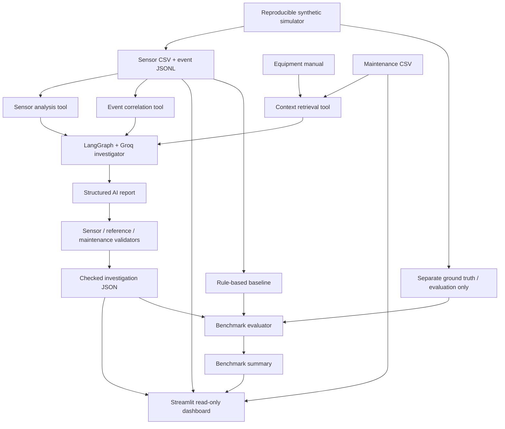

# IncidentLens — AI Incident Investigator
**🌐 [Live Dashboard](https://incidentlens-aii.streamlit.app/)** · [GitHub Repository](https://github.com/AhireRohit/IncidentLens-AI)


**Explainable investigation of simulated industrial equipment incidents using LangGraph, Groq, time-series telemetry, event logs, equipment documentation, and maintenance history.**

IncidentLens is an applied AI/ML portfolio project that turns raw conveyor telemetry into an evidence-grounded incident report. Instead of trusting an LLM's explanation by itself, the pipeline checks cited sensor values, source references, and maintenance dates against the input files.

> **Portfolio demo:** The included Streamlit dashboard is **read-only**. It displays previously generated and validated reports. It does not call Groq, control machinery, or require API credentials.
>
> **Screenshot:** After launching the dashboard, capture a screenshot and optionally add it here as `docs/dashboard.png`.

## What it does

- **Sensor analysis:** Reads second-by-second motor temperature, current, conveyor speed, vibration, cooling flow, and controller state.
- **Event correlation:** Matches alarm IDs and timestamps to the original sensor readings.
- **Context retrieval:** Selects relevant alarm definitions, troubleshooting guidance, and maintenance records.
- **Agentic investigation:** A LangGraph agent uses Groq-powered tool calls to gather evidence and draft a structured diagnosis with alternative hypotheses and next checks.
- **Evidence checks:** Python validators independently check sensor claims, citation IDs, maintenance dates, and basic output structure.
- **Repeatable experiments:** Simulated incidents have separate, evaluator-only ground truth; a rule-based classifier provides a comparison baseline.
- **Streamlit dashboard:** Explore telemetry, alarms, validated reports, maintenance records, and benchmark aggregates without generating new LLM responses.

## Dashboard

The read-only dashboard includes five views:

| View | Contents |
| --- | --- |
| Overview | Root-cause hypothesis, reported confidence, key metrics, temperature and cooling charts |
| Telemetry | Interactive time-series plots with reference thresholds and logged alarm markers |
| Events & timeline | Raw event sequence and AI-generated, referenced timeline |
| Evidence & maintenance | Source citations, validation counts, maintenance records, downloadable report |
| Benchmark | Aggregate synthetic benchmark results, completion coverage, and rule-based comparison |

**Screenshots are not included until you capture one from your own running app.**

## Architecture



The LLM **never receives `data/ground_truth/` as input**. That directory is used only by the separate evaluation scripts.

## Tech stack

| Layer | Tools |
| --- | --- |
| Language/data | Python, pandas, CSV, JSONL |
| Agent orchestration | LangGraph, LangChain tools |
| LLM provider | Groq (`openai/gpt-oss-120b` in the tested local setup) |
| Visualization | Streamlit, Altair |
| Reliability | Source-reference validation, sensor-value checks, maintenance-date validation, evidence checkpoints |
| Evaluation | Synthetic ground truth, a rule-based sensor threshold baseline |

## Quick start — dashboard only

**Requirements:** Python 3.10+ and a repository containing `data/generated/` with at least one `sensor_readings.csv`. Run these commands from the project root.

```powershell
# Use your existing .venv if already created
.\.venv\Scripts\Activate.ps1
python -m pip install -r requirements-dashboard.txt
streamlit run app.py
```

Streamlit opens a local browser tab. Select a scenario in the sidebar. Cases without a `checked_investigation.json` still show their telemetry and event history, but **the dashboard will not fabricate an AI diagnosis**.

**The dashboard does not need `.env`, a Groq API key, or the LangGraph dependencies.**

### Expected local project layout

```text
AI-Incident-Investigator/
├── app.py                       # read-only Streamlit dashboard
├── README.md
├── requirements-dashboard.txt  # demo-only dependencies
├── requirements.txt            # cloud demo dependencies (merge if already present)
├── .streamlit/
│   └── config.toml
├── investigator/
│   ├── agent_graph.py           # tool-using LangGraph agent
│   ├── sensor_analysis.py
│   ├── event_analysis.py
│   ├── context_retrieval.py
│   ├── sensor_validation.py
│   ├── reference_validation.py
│   └── report_validation.py
├── simulator/
│   ├── generate.py
│   ├── mechanical_jam.py
│   ├── randomized_jam.py
│   └── batch_generate.py
├── evaluation/
│   ├── evaluate.py
│   ├── baseline.py
│   └── benchmark.py
└── data/
    ├── reference/equipment_manual.md
    ├── generated/
    │   ├── normal/
    │   ├── cooling_failure/
    │   ├── mechanical_jam/
    │   └── case_0202/
    │       ├── sensor_readings.csv
    │       ├── events.jsonl
    │       ├── maintenance.csv
    │       └── checked_investigation.json
    ├── evaluation/benchmark_summary.json
    └── ground_truth/             # evaluator-only; do NOT deploy
```

Existing simulations and local files may vary; the dashboard discovers scenario folders rather than assuming a fixed list.

## Running a new AI investigation (optional, locally)

Your existing full-agent Python environment needs LangGraph, LangChain, `langchain-groq`, `groq`, `python-dotenv`, and other dependencies already used by the repository. **Do not replace that environment's requirements with the dashboard-only list if you use the CLI investigator.**

Configure a local `.env` (never commit it):

```env
GROQ_API_KEY=your_key_here
```

Generate or select a case and run:

```powershell
# Optional: prepare local evidence without an LLM call
python -m investigator.agent_graph --scenario case_0303 --prepare-checkpoint

# Uses Groq to generate a report; subject to account quotas
python -m investigator.agent_graph --scenario case_0303

# Evaluate only after checked_investigation.json exists
python -m evaluation.evaluate --scenario case_0303

# Aggregate all generated cases, including missing reports
python -m evaluation.benchmark
```

The investigator saves `checked_investigation.json` only when the three existing validation checks pass. A report that fails validation must not be displayed as verified. Evidence checkpoints can reduce repeated tool-selection calls but do not eliminate final LLM calls or provider quotas.

## Dataset schema

**Sensor telemetry** — `data/generated/<scenario>/sensor_readings.csv`:

```csv
timestamp,machine_id,motor_temp_c,motor_current_a,conveyor_speed_mps,vibration_mm_s,cooling_flow_lpm,controller_state
2026-01-15T14:00:00,conveyor_2,44.0,7.96,1.198,1.163,11.99,RUNNING
```

**Events** — one JSON object per line in `events.jsonl`:

```json
{"event_id":"EVT-001","timestamp":"2026-01-15T14:14:00","component":"cooling_unit","event_code":"COOLING_FLOW_LOW","message":"Cooling flow dropped below operating range"}
```

Other input artifacts are `maintenance.csv` (record ID, timestamp, machine ID, component, maintenance type, observation, status) and `data/reference/equipment_manual.md` (operating thresholds and troubleshooting procedures). Each synthetic scenario has a separate hidden ground-truth record for evaluator-only use.

### Simulated failure modes

- **Cooling-flow loss:** Cooling flow decreases, motor temperature rises, and thermal protection eventually stops the conveyor.
- **Mechanical jam:** Increasing load raises motor current and vibration, reduces conveyor speed, and triggers overload protection.
- **Intermittent temperature-sensor fault:** The reported temperature jumps unrealistically while other operating indicators remain normal.
- **Normal operation:** No injected fault or logged alarms.

The project includes an output label for `communication_outage`, but a complete, tested simulator for that fault is **not** included among the demonstrated cases.

## Evaluation — development results

Results recorded during the **October 29, 2026** development runs:

| Metric | Observed |
| --- | ---: |
| Generated synthetic cases | 13 |
| Completed, evidence-validated AI reports | 7 |
| Correct labels among those 7 reports | 7 / 7 |
| Baseline correct across all 13 generated cases | 10 / 13 (76.92%) |
| Missing/uncompleted AI reports | 6 |
| AI end-to-end success across generated cases | 7 / 13 (53.85%) |

**Interpretation:** The seven completed AI investigations were correctly classified and passed the implemented evidence checks. Six other cases were incomplete during the benchmark run, predominantly because of **Groq token rate limits**. Consequently, 7/7 is *not* an unbiased estimate of diagnostic accuracy over all generated cases, and the 7/13 end-to-end figure reflects availability/incompletion as well as correctness. The baseline and completed-report AI percentages have **different denominators** and should not be presented as a definitive head-to-head result.

In one demonstrated temperature-sensor-fault case, the AI predicted the correct label while the simple threshold baseline returned `unknown`. This is a useful capability demonstration, **not proof of general LLM superiority**.

All samples are synthetic development data with simplified physics, not independently held-out industrial recordings.

## Deployment — Streamlit Community Cloud

1. Commit `app.py`, `README.md`, `.streamlit/config.toml`, and a **root `requirements.txt`** that includes `streamlit`, `pandas`, and `altair`. If the repository already has `requirements.txt`, **merge these dependencies rather than deleting the agent dependencies**.
2. Commit a **small selection of synthetic demo folders**, such as `data/generated/normal/`, `data/generated/mechanical_jam/`, and `data/generated/case_0202/`. Include the saved `checked_investigation.json` where available. The app does not create reports itself.
3. Optionally commit `data/evaluation/benchmark_summary.json` to show aggregate benchmark results.
4. Open [share.streamlit.io](https://share.streamlit.io), choose **Create app**, select the GitHub repository/branch, and use **`app.py`** as the entrypoint.
5. Once the app loads, take a screenshot and add the hosted URL to your GitHub repository description.

Community Cloud runs the entrypoint from the repository and installs packages listed in its requirements file. See the [official deployment instructions](https://docs.streamlit.io/deploy/streamlit-community-cloud/deploy-your-app/deploy).

**Do not push** `.env`, Groq keys, `data/ground_truth/`, or private machine logs to a public repository. If `data/generated/` is ignored in Git, explicitly add *only* the synthetic demo folders you intend to publish. The public dashboard intentionally has no live LLM endpoint.

## Limitations and next steps

- Fault models and maintenance records are **synthetic**, and simplified alarm thresholds do not represent a certified industrial controller.
- Automated validators test submitted sensor claims, reference IDs, maintenance dates and some output structure; they **do not prove the causal narrative** or catch every unsupported omission.
- Keyword-based maintenance retrieval can surface irrelevant records; semantic retrieval and coverage checks are potential improvements.
- Groq rate limits can interrupt investigations. The UI avoids this by showing saved validated reports only.
- Stronger research claims would require a predefined, held-out benchmark, larger varied sample, uncertainty calibration, and ideally real industrial data.

## Safety

For **education and portfolio demonstration only**. The project does not operate equipment or authorize restarts, bypassing safety interlocks, or maintenance decisions. Diagnosis is a hypothesis requiring qualified on-site verification.

---

**Project focus:** agentic AI · evidence grounding · time-series analysis · retrieval · software reliability · reproducible evaluation.
